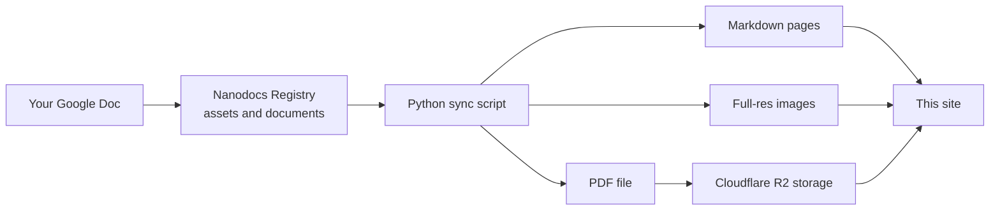

# How This Site Is Built

Curious what happens between your Google Doc and the page on this site? Here
is the whole pipeline.

## The pipeline

1. **You write in Google Docs.** The doc is the single source of truth — the
   site never holds content of its own.
2. **The Nanodocs Registry lists what's published.** It is one spreadsheet with three tabs. `assets` is the tool or hood (its id is the permanent address; its name is the sidebar label). `documents` is one Google Doc about that asset: the sidebar label, the on-page title, who it's for (`public` for the site), and the doc link. A policy or the signup page is a document with no asset. `groups` is the heading those assets sit under (Deposition, Wet Processing) and which tab of the site they appear on. If a row isn't in the sheet, it isn't on the site. A tool can be listed before it has a document; it gets a page only once a document is published.
3. **A sync script converts each doc.** It downloads the doc straight from
   Google in three formats:
    - **Markdown** becomes the web page you're reading. The script strips
      things that don't belong on a website — the letterhead, the doc's title
      line, and the doc's table of contents (the site generates its own live
      one from your headings).
    - **DOCX** is used only to recover your images at **full resolution**,
      since Google's web conversion shrinks them.
    - **PDF** is saved so every page can offer "View PDF" and "Download
      PDF" next to a link to the original doc.
4. **The site is rebuilt and published** to
   [nanodocs.pages.dev](https://nanodocs.pages.dev) (Cloudflare Pages).
   Every page ends up searchable, readable on phones, and in step with
   the docs.

### Addresses, the asset page, and the sidebar

A tool or hood with a published document gets its own page, written from the asset row: the name as the heading, then the description, manufacturer, and model when those cells are filled. That page has no PDF. The Google Docs sit underneath it. The tool name in the sidebar opens this page; `SOP` is the row under it.

The address follows the sheet:

- a tool SOP is `/tools/<group>/<asset id>/sop/`
- an etch under a hood is `/chemicals/wet-processing/<hood id>/<slug of the label>/`
- a policy is `/policy/<slug of the label>/`

The asset `id` does not change. Renaming the asset's `name` changes the sidebar label and leaves the address where it is. Renaming a document's `label` moves that page, and the old address keeps working. The on-page heading is the document's `title`, which can change without moving the address or the PDF.

Sidebar order is kept in this repo, not in the sheet. A new row appears at the bottom of its list the next time the site syncs; someone then moves that line to where it should sit. Sorting the sheet does nothing to the site.

### Where the PDFs live

The pages and images are hosted on Cloudflare Pages. The PDFs are not:
Cloudflare will not accept a single file larger than 25 MB, and some tool
SOPs exceed that. So the PDFs are stored in a Cloudflare **R2** bucket
(`nanodocs-pdfs`) and the site fetches them when you click View or
Download. The buttons still look like ordinary links on this site; a small
Pages Function maps `/assets/pdfs/…` to the matching file in the bucket.

On a laptop, the sync still writes the PDF next to the pages so local
preview works without the cloud. After a doc's PDF changes, that file also
has to be uploaded to R2 or the live View PDF button stays on the old
copy. Details and commands are in the repo [README](https://github.com/asrc-nanofab/nanodocs#deploying).

## What this means for you

- **Edit the doc, never the site.** Site files are overwritten on every sync.
- **You only edit the doc.** The sync extracts the page, images, and PDF.
  Getting a new PDF onto the live site is a short upload step for whoever
  runs the repo (see the README), not something authors do in Google Docs.
- **Readers can always reach the original**: every page links to a read-only
  preview of your Google Doc.

## What this means for your readers

- **Readable anywhere.** Pages adapt to any screen — a phone at the tool, a
  desktop in the office — far more comfortably than a PDF.
- **Searchable.** Every page is indexed, so one search box covers all SOPs
  and policies.
- **Always current, still printable.** Pages stay in step with the source
  docs, and a PDF copy is one click away when paper is better.

## A chat that reads the published site

There is also a **docs chat**: not the search box, but an assistant that
retrieves from the whole live corpus, answers in plain language, and cites
the pages it used. What it does — and why its answers come with source
cards — is explained in [How the Docs Chat Works](how_chat_works.md).
The service wiring (a sibling Cloudflare Worker plus an AI Search index of
this site — not a plugin dropped into the Google Doc pipeline) is in
[Wiring a chat agent into your documentation](chat_agent.md).
