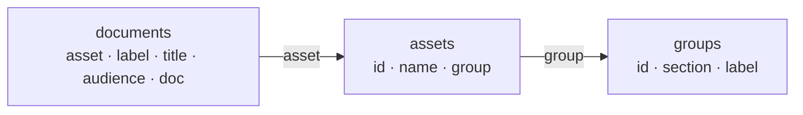

# Make the registry sheet the source of truth: assets, documents, groups

**Date:** 2026-10-09
**Status:** Phase C in progress — new PDF keys are in R2. Supersedes `2026-10-09-sheet-owns-page-path.md`
**Branch:** `create-assets-docs-groups`

## Description

Nanodocs is rendered from three Google Sheets, but the sheets only hold
names and links. The site path, the sidebar group, the hood an etch
belongs to, and the folder-vs-file choice all live in Python
(`TOOL_CATEGORY_DIRS`, `TOOL_PAGE_OVERRIDES`, `CHEM_PAGE_MAP`,
`POLICY_PAGE_MAP`). Two plans tried to fix that and each missed:

| Plan | What it gets right | Why it is not quite right |
| --- | --- | --- |
| `2026-10-09-sheet-owns-page-path` | One `Share Link`; sheet owns the path; Python maps deleted. | Still one row per *page*, so a hood row is both the asset and its SOP. Folder-ness is inferred from another row's `Parent`. Every path, including a tool's, is `slugify(Name)`, so renaming a tool moves its URL even though the sheet already has a permanent `Programmatic ID`. `Class` is free text per row. No audience. Three sheets keep three different column sets. |
| `2026-10-06-asset-document-graph` | Asset ≠ document. A document is *about* an asset. Documents have `type` and `audience`. A policy has no asset. | It is NanoKnow's data model (four tables, subclass taxonomy, `kind`, `depends_on`) and says so: "not a change to the sync script or the public site." Its id rule (`fiji-ald`, never a bare subclass) contradicts the `Programmatic ID` column that already exists in the tools workbook (`ald`, `pecvd`). "Nanodocs as a view" is left as an open question. |

The tools workbook already has the shape the Oct 6 plan wants. Its tabs are:

| Tab | What it is | Read by the sync? |
| --- | --- | --- |
| `Tool List` | An **asset table**: `Name - Short`, `Name - Full`, `Manufacturer`, `Model`, `Type (Category)`, `Programmatic ID` | No |
| `Staff Tool List` | An asset attribute: `Name - Short` → staff | No |
| `Document URLs` | A **document table**: `Tool Name`, `Type (Category)`, `Share Link`, `PDF Link` (a formula) | Yes — the only tab read |

The chem workbook mixes both kinds in one tab (`Type` = `Hood` is an
asset, `Type` = `Etch` is a document) and the hood each etch belongs to
exists only in `CHEM_PAGE_MAP`. The policy workbook is documents only.

This plan takes the Oct 6 split — asset, document, link — and makes it
the registry nanodocs reads, at the smallest size that covers the site
today. Everything heavier in Oct 6 (subclass taxonomy, `kind`,
`depends_on`, document `type`, NanoKnow tables) stays deferred, and this registry becomes
the asset list of record that NanoKnow imports later, which answers Oct
6's open question "where the asset list lives".

### The model

Three tabs in one workbook. A row is a node; a cell that names another
row's id is the edge.



- An **asset** is a thing people are trained on: a tool, a hood, a furnace. It exists whether or not it has a document (Ozone Cleaner has a row and no page). On the site, an asset with a published document is a directory. Its home page is a Google Doc.
- A **document** is one Google Doc published as one page. It is *about* at most one asset. A document with no asset is a facility document (policy, signup). The document labeled `SOP` is the asset's home page.
- A **group** is what an asset is (`deposition`, `wet-processing`) and the sidebar heading those assets sit under. Each group belongs to a **section**, the top-level tab it is shown in. Hoods are assets in group `wet-processing`; that group's section is `chemicals`, so they stay on the Chemical Handling tab. The asset says what it is; the group says where it is shown.

Audience is on the document, as the Oct 6 plan has it. The site build
publishes `public` rows; the staff preview (`plans/2026-08-20-staff-preview-server.md`)
can publish `public` + `staff` later with one flag. The columns exist
now; the filter is one line.

### Growth rule

- `id` values are permanent. Rename `name` or `label`, never `id`. Replacing a machine is a new row with a new id. A document's URL follows its `label`; the sync writes the redirect.
- Columns can be added to any tab at any time. The sync reads the columns it knows and ignores the rest. `description`, `manufacturer`, and `model` stay on the assets tab and are not read.
- Vocabularies (`audience`, `section`) are short lists in the sync. Adding a value is a one-line change plus whatever renders it.
- An asset directory exists because the asset has a published document. The caret is the one inference from sibling rows: it exists only when another published document sits beside the home page.

The first growth steps, none of which change this schema: a `type`
column on `documents` once its vocabulary is known, a `short_name`
column on `assets` if the Staff Tool List is read, a `parent`
column on `assets` (the PECVD chiller), a `status` column on
`documents` (`draft` / `current` / `superseded`), and a `nanoknow_id`
crosswalk column on `assets` if NanoKnow adopts the Oct 6 id rule.

## Schema

Three tabs. Header names are lower-case snake so the contract is visible
in the sheet. The sync fails loudly on a missing required column and
ignores columns it does not know, so attribute columns can be added at
will.

### Every tab and column

| Tab | Column | Required | What it holds | Where it comes from today |
| --- | --- | --- | --- | --- |
| `groups` | `id` | yes | Folder segment under the section: `deposition`, `etching`, `wet-processing`. Lower-case, hyphens. Permanent. | `TOOL_CATEGORY_DIRS` values |
| `groups` | `section` | yes | The tab the group is shown in: `tools`, `chemicals`, or `policy`. The Tools tab's heading in `docs/.nav.yml` is `Tools`. | which workbook |
| `groups` | `label` | yes | The bold sidebar heading: `Deposition`, `Wet Processing`. | `title:` in the group's `.nav.yml` |
| `assets` | `id` | yes | Permanent slug; the URL segment and the key documents point at. Lower-case, hyphens. Never edited once published. | `Programmatic ID` |
| `assets` | `name` | yes | Sidebar label for the asset: `Oxford PECVD`, `Fiji ALD`. Free to edit; the URL does not move. | the label in `.nav.yml` |
| `assets` | `group` | yes | A `groups.id`. Says what the asset is and, through the group, where it is shown. | `Type (Category)` |
| `assets` | `description` | no | What the machine is: `Plasma Enhanced Chemical Vapor Deposition`. The sync ignores it. | `Name - Full` |
| `assets` | `manufacturer`, `model` | no | The sync ignores both. | same |
| `documents` | `asset` | no | An `assets.id`. Blank for a facility document (policy, signup). | `Tool Name` / `CHEM_PAGE_MAP` |
| `documents` | `label` | yes | Sidebar text, and the source of the URL: the file is `slugify(label).md`. | the label in `.nav.yml` / `*_PAGE_MAP` |
| `documents` | `title` | yes | The on-page H1: `Atomic Layer Deposition (ALD) SOP`, `ASRC Nanofab -- Rules of Conduct`. | the H1 on disk; tool SOPs gain a trailing ` SOP` when the H1 lacks one |
| `documents` | `section` | when `asset` blank | `policy`, or blank for the docs root (`signup`). Ignored when `asset` is set; the asset's group supplies it. | which workbook |
| `documents` | `audience` | yes | `public`, `staff`, `admin`. The public build publishes `public`. | — |
| `documents` | `doc` | yes | The one Google Doc URL. Preview, Markdown, DOCX, and PDF export URLs are derived from its id. Blank = registered but unpublished. | `Share Link` + `PDF Link` |

Row order carries no meaning. Sidebar order is set in the repo's
`.nav.yml` files (see Sidebar).

### Notes per tab

**`groups`.** A group with no published asset produces no folder
(`furnace` today). A section's tab, its hand-written `index.md`, and its
entry in `docs/.nav.yml` exist whether or not any group points at it.

**`assets`.** The existing `Tool List` tab with headers renamed and the
hoods added. One tab for every asset kind. An asset has no section of
its own; it is shown wherever its group's section is. `id` and `name`
are kept separate because asset URLs are the ones people bookmark and
the chat widget cites, and the ids already exist.

**`documents`.** One row is one Google Doc page. `label` is both the
sidebar text and the URL — renames are rare, and when one happens the
sync writes a redirect (below), so there is no separate slug column to
keep in step. `title` is the H1 of that page, including when the page is
the asset's home. The sidebar label of the home page is the asset's
`name`, so `SOP` does not appear as its own row. Document `type` is not a column yet. A tool SOP,
a hood page, and an etch page differ by `asset` and `label`. Add `type`
when the vocabulary is settled.

### Path rule

```text
asset dir = docs / section / group / asset
home      = index.md                                 the asset's home document
other     = <asset dir> / slugify(label).md          every other document
facility  = docs / section / slugify(label).md       when asset is blank
                                                       (section omitted when blank)
```

`slugify` lower-cases and turns every run of non-alphanumerics into one
hyphen: `Rules of Conduct` → `rules-of-conduct`, `C14 Application` →
`c14-application`, `Hydrofluoric Acid Etch` → `hydrofluoric-acid-etch`.

When `asset` is set, `group` is the asset's group and `section` is that
group's section. When it is not, `section` is the document row's own and
there is no group.

The home document is chosen from the asset's document rows, published or
not, so an unpublished sibling does not move the SOP:

- A row labeled `SOP` is the home page. Two `SOP` rows on one asset fail validation.
- An asset with exactly one document row, and that label is not `SOP`, uses that row as the home page.
- An asset with two or more document rows and no `SOP` label fails validation. The sync does not guess.

| Row | Path | URL |
| --- | --- | --- |
| asset `pecvd`, label `SOP` | `tools/deposition/pecvd/index.md` | `/tools/deposition/pecvd/` |
| asset `pecvd`, label `Oxide Recipe` | `tools/deposition/pecvd/oxide-recipe.md` | `/tools/deposition/pecvd/oxide-recipe/` |
| asset `caustics-hood`, label `SOP` | `chemicals/wet-processing/caustics-hood/index.md` | `/chemicals/wet-processing/caustics-hood/` |
| asset `caustics-hood`, label `Gold Etch` | `chemicals/wet-processing/caustics-hood/gold-etch.md` | `/chemicals/wet-processing/caustics-hood/gold-etch/` |
| no asset, section `policy`, label `Safety Manual` | `policy/safety-manual.md` | `/policy/safety-manual/` |
| no asset, section blank, label `Nanofab Signup` | `nanofab-signup.md` | `/nanofab-signup/` |

Adding another document adds a file beside the home page and does not
move it. Document images go to `<asset dir>/img/`. An asset with no
published document produces no directory (Ozone Cleaner, the furnaces).

The PDF key is derived from the document path, not the display name.
The home SOP's key is `<section>/<group>/<asset>/index.pdf` under
`docs/assets/pdfs/` and in R2. The `download=` attribute on the
Download pill supplies the friendly filename from `title`. Renaming a
title no longer renames an R2 key. Phase C has not uploaded the new
keys, so the home key changing from `sop.pdf` to `index.pdf` is free.

### Home page

The home page is the Google Doc, written with the same pill links as
every other document. The H1 is that document's `title`. An asset with
no published document stays a row in the sheet and gets no directory,
no `index.md`, and no sidebar entry.

There is no page generated from the asset row. Phase B wrote one for
every asset that had a document; Phase B2 overwrites it with the SOP.
`description`, `manufacturer`, and `model` are not printed. Group
landing pages (`deposition/index.md`, `chemicals/index.md`) stay
hand-written. Their links already point at `<asset>/index.md` and do
not change; that URL becomes the SOP.

### Redirects

The sync already keeps `.sync-state.json` keyed by Google Doc id. It
gains the last path written for each doc. When a row's resolved path
differs from the remembered one — a label edit, an asset moved to
another group — the sync appends the old URL → new URL line to
`docs/_redirects`, which Cloudflare Pages serves natively. A rename
therefore costs nothing and old bookmarks, QR codes, and chat citations
keep working. Phase B seeded the file with every URL the migration
moves. Those tool and hood lines pointed at `…/sop/`. Phase B2 retargets
them at the asset URL. `append_redirect` will not rewrite an existing
source line, so that edit is in place. The same run appends a new line
for each home SOP, `…/sop/` → `…/`, because `.sync-state.json` still
remembers `sop.md`.

### Sidebar

Order lives in the repo; labels and membership live in the sheet.
`.nav.yml` files stay hand-written, and the sync merges into them
rather than replacing them. For each directory that holds a page it
published, the sync:

- rewrites the label of every entry whose path it generated, to the sheet's `name` (asset directory), `label` (document), or group `label` (group directory);
- appends an entry for any published page or asset directory that has no entry, at the end of the list;
- never reorders and never removes a line. A group entry whose target changes (`pecvd` to `pecvd/index.md`, or the reverse when a second document is published) goes stale until that line is deleted. The one exception is `<asset dir>/.nav.yml` itself, which the sync deletes when the asset no longer has two published documents and every entry in the file is one the sync generated.

The entry shapes are the ones awesome-nav already reads:

| Directory | Entry the sync maintains |
| --- | --- |
| `<section>/` | `label: <group id>` for each group with a published asset; for `policy`, `label: <slug>.md` for each asset-less document |
| `<section>/<group>/` | `name: <asset id>/index.md` when the asset has one published document; `name: <asset id>` when it has two or more |
| `<asset dir>/` | created only when the asset has two or more published documents: `index.md` first, then `label: <slug>.md` for each document that is not the home page |

A published document has a non-blank `doc` and an `audience` equal to
the build's (`public` by default). The home page is not listed a second
time. `navigation.indexes` makes the asset's `name` the link to
`index.md`, which is the SOP.

One published document is a single link. When the group has its own
`index.md`, the group entry points at `<asset id>/index.md` and the
asset directory has no `.nav.yml`. The sync deletes that file when the
asset has fewer than two published documents, unless it contains a
target the sync did not generate.

Wet Processing has no `index.md`. A direct child whose target is
`<asset id>/index.md` is an index page, and the theme uses the first
index page as the group heading's link, which hides that asset. Those
assets are listed as `<asset id>` with a `.nav.yml` whose only entry is
`index.md`. The theme draws that as a link with no caret. Discovered
while executing Phase B2.

Two or more published documents is a caret. The group entry is the
directory name, so awesome-nav loads `<asset dir>/.nav.yml`. The asset
name opens the SOP. The other documents are the rows under the caret.

The samples have 24 assets with only an SOP (the 21 tools, plus
`litho-hood`, `solvent-hood`, and `rca-hood`) and two with more
(`caustics-hood`, `hf-piranha-hood`). Only those two are carets.

Everything else in those files is yours: the order, the hand-written
group landing pages, hand-written pages dropped into a generated
directory, and `docs/.nav.yml` itself (Home, FAQ, Signup, Authoring),
which the sync never opens. A group without a hand-written `index.md`
is a heading with no landing page, which the theme renders fine;
`wet-processing` can start that way.

Sorting or filtering the sheet therefore changes nothing on the site.
A new row shows up at the bottom of its list on the next cron run; move
it where you want it in the repo. An entry whose page moved (a label
edit, an asset in a new group) goes stale, and `zensical build --strict`
fails on it until the line is deleted — the merge appends the new entry
but will not guess that the old one is the same page.

Under Chemical Handling the tab stays, then a bold "Wet Processing"
heading. Litho-Development, Solvent Lift-Off, and RCA are links to the
hood SOP. Caustics and HF and Piranha are carets: the hood name opens
the SOP, and the etch pages are the rows inside the caret. Phase A
accepted a caret on every asset that had a document. That decision is
reversed here, before Phase B sign-off.

### Consistency check

A `--check` mode, runnable on its own and as the last step of every sync,
reports and exits non-zero when:

- a published row has no entry in its directory's `.nav.yml` (cannot happen after a merge, but catches a hand-deleted line);
- a `.nav.yml` entry the sync generated carries a label that differs from the sheet;
- a page on disk starts with the `AUTO-GENERATED` marker but no document row resolves to it (a row deleted from the sheet, a label edit that left the old file behind, or a Phase B `sop.md` left beside the home page);
- a `_redirects` source still exists as a page.

The first two are the sheet-to-tree direction; the third is the
tree-to-sheet direction, which `--strict` cannot see because an orphaned
page is still a valid page. This can land after Phase C; the merge
alone keeps the public sidebar correct.

### Validation

The sync stops the run with the row and the reason. It never guesses.

- `assets.id` or `groups.id` duplicated; `id` not lower-case `[a-z0-9-]`.
- `assets.group` not in `groups`; `groups.section` or `documents.section` not in the section list.
- `documents.asset` not in `assets`.
- An asset with two documents whose labels slugify the same, or with two rows labeled `SOP`.
- An asset with two or more document rows and no row labeled `SOP`.
- An asset with a published document whose home document is not published for that same audience. A blank `doc` is not published.
- A document with no `label`, or with no `title`.
- `audience` not in its vocabulary.
- Two rows resolving to the same path.
- A duplicate `doc` URL.

One Google Doc backs one page. A duplicate `doc` value fails validation,
because `.sync-state.json` remembers one path per doc id. The RCA
Cleaning Procedure row was dropped: it pointed at the Piranha doc, and
the live page was that SOP under a different H1. The RCA hood keeps its
own SOP row.

## Migration of today's rows

What Phase A fills in. Asset `name` is today's sidebar text. Document
`title` is today's H1, and a tool SOP gains a trailing ` SOP` when that
H1 does not already end in it. The three tabs, fully populated from the
live sheets and the current pages, are in `plans/registry-samples/`
(`groups.csv`, `assets.csv`, `documents.csv`) — import each as a tab to
see the shape.

### `groups`

| id | section | label |
| --- | --- | --- |
| lithography | tools | Lithography |
| deposition | tools | Deposition |
| etching | tools | Plasma Etching |
| metrology | tools | Metrology |
| packaging | tools | Packaging |
| furnace | tools | Furnace |
| wet-processing | chemicals | Wet Processing |

### `assets`

All 41 `Tool List` rows carry over with
`group = lower(Type (Category))`, `id = Programmatic ID`. The 21 with
documents get `name` from today's nav label, e.g. `ald` → `Fiji ALD`
(the nav says "Fuji"; the Model column says Fiji G2), `metal-evap` →
`AJA Metal Evaporator`, `rie` → `Reactive Ion Etcher`, `elionix-100kev`
→ `Elionix E-Beam Lithography`. The 20 without documents get `name` =
`Name - Short` for now.

Five new rows for the hoods, `group = wet-processing`:

| id | name |
| --- | --- |
| litho-hood | Litho-Development Hood |
| solvent-hood | Solvent Lift-Off Hood |
| caustics-hood | Caustics/Metal Etch Hood |
| hf-piranha-hood | HF and Piranha Hood |
| rca-hood | RCA Hood |

`SRD` (spin rinse dryer) is filed under `lithography` in `Tool List`;
the Oct 6 sample put it in wet processing. It has no document, so it is
a cell edit whenever that is decided.

### `documents`

The pages that are the tool or the hood today get `label` `SOP`. A tool
document's `title` is today's H1, with ` SOP` appended when the H1 does
not already end in it (`Oxford 80 RIE` → `Oxford 80 RIE SOP`; `Elionix
EBL 100keV SOP` stays). Hood and etch titles stay today's H1. The etch
pages keep today's sidebar text as `label`. Facility documents are
unchanged.

| asset | label | title | audience |
| --- | --- | --- | --- |
| each of the 21 tools with a link | SOP | today's H1, plus ` SOP` when missing (`Atomic Layer Deposition (ALD) SOP`, `Oxford 80 RIE SOP`) | public |
| litho-hood, solvent-hood, caustics-hood, hf-piranha-hood, rca-hood | SOP | today's H1 (`Caustics and Metal Etch Hood` …) | public |
| caustics-hood | Aluminum Etch | Aluminum Etch | public |
| caustics-hood | Chrome Etch | Chrome Etch | public |
| caustics-hood | Gold Etch | Gold Etch | public |
| caustics-hood | Silicon Etch | Isotropic Silicon Etch | public |
| caustics-hood | Nickel Etch | Nickel Etch SOP | public |
| hf-piranha-hood | Hydrofluoric Acid Etch | Hydrofluoric Acid Etch | public |
| hf-piranha-hood | Piranha Clean | Piranha Clean | public |
| — (section policy) | Rules of Conduct | ASRC Nanofab -- Rules of Conduct | public |
| — (section policy) | Safety Manual | ASRC Nanofab Facility -- Safety Manual | public |
| — (section policy) | C14 Application | Instruction for C-14 Application | public |
| — (section policy) | Suspension Policy | Lab Suspension Policy | public |
| — (section blank) | Nanofab Signup | Becoming a Nanofab User | public |

`doc` is today's `Share Link` for each. The asset URL is the SOP.
Today's tool and hood URLs redirect to that URL, not to a `sop.md`
child: `/tool_sops/deposition/aja_sputter/` →
`/tools/deposition/aja-sputter/`. The same for every hood. Phase B
seeded the destinations as `…/sop/`; Phase B2 rewrites them. Other URL
changes: the tools section `tool_sops/` → `tools/`,
tool ids with hyphens, `etch/` → `etching/`,
every hood gains the `wet-processing/` segment, every policy page
(`manual` → `rules-of-conduct`, `c14` → `c14-application`), and `signup`
→ `nanofab-signup`. Phase B seeds `docs/_redirects` with all of them.
`docs/.nav.yml` is hand-written. Its Tools entry replaces today's
`Tool SOPs: tool_sops`, and its Signup entry is updated to the new path.

### What this does to the earlier plans

- `2026-10-09-sheet-owns-page-path`: superseded. Keeps one `Share Link` with all export URLs derived, and keeps slugified names for documents (with redirects on rename). Drops `Class`/`Parent`, and uses the permanent `Programmatic ID` for assets instead of slugifying their names.
- `2026-10-06-nested-tool-sections`: a caret exists only when the asset has a published document besides its home page, and the home page is the SOP. The hand-written `pecvd/pecvd_processes.md` sample goes away in Phase B.
- `2026-10-06-asset-document-graph`: unchanged in intent; its Phase B (NanoKnow tables) imports `assets` from this workbook instead of maintaining a second list. Document `type` stays in that model and is not a column here until its vocabulary is chosen. Its id rule applies to NanoKnow's own key, with a crosswalk column here if the two ever differ. `plans/asset-graph-samples/assets.csv` already has that crosswalk shape (`registry_name`).

## Steps

### Phase A — Build the three tabs

A new workbook, [Nanodocs Registry](https://docs.google.com/spreadsheets/d/1wuT0MT50EOu8GzAxCS05bQzJCV9Hevwk7dXe9B28wBo/edit),
id `1wuT0MT50EOu8GzAxCS05bQzJCV9Hevwk7dXe9B28wBo`. The live tools workbook
(`1b4RRhKAukj9NrFyiJl_I9vbAUnrgDSy1TeNq2QLKJr4`), including `Document URLs`
and `Tool List`, stays untouched, as do the chem and policy workbooks.
The current sync keeps working until Phase C.

| Tab | gid |
| --- | --- |
| `groups` | `1564656206` |
| `assets` | `0` |
| `documents` | `1004610326` |

- [x] Add a `groups` tab: import `plans/registry-samples/groups.csv`. 7 rows. Etching's label is Plasma Etching.
- [x] Add an `assets` tab: import `plans/registry-samples/assets.csv` (46 rows — the 41 tools with renamed headers plus the five hoods). `Tool List` in the old workbook is unchanged.
- [x] Add a `documents` tab: import `plans/registry-samples/documents.csv` (38 rows — 21 tool SOPs, 12 hood pages, 5 facility documents). The RCA Cleaning Procedure row is omitted.
- [x] Shared so each tab exports as CSV. Exports match the samples (Google adds CRLF and drops the trailing newline).

### Phase A review gate — STOP for sign-off

- [x] Every `Programmatic ID` is the id you want in URLs for good. Changing one later is a redirect, not a cell edit. Accepted by proceeding.
- [x] One workbook for all three sections is acceptable. Nanodocs Registry holds `groups`, `assets`, and `documents`.
- [x] The `audience` vocabulary is right: `public`, `staff`, `admin`. Accepted by proceeding.
- [x] `label` doubling as the URL is acceptable: a label edit moves the page and writes a redirect. Signup stays `nanofab-signup` under that rule.
- [x] The asset URL is the generated index, and today's SOP moves to `sop.md` under it. Old SOP URLs redirect to that file. The caret stays, including for an asset with one document. **Reversed** before Phase B sign-off. The SOP is `index.md`. A caret exists only when another published document sits beside it. Phase B2 does the reversal.
- [x] The migration's URL changes are acceptable. Accepted by proceeding.
- [x] Decision: proceed.

### Phase B — Sync reads the registry

On a branch. Cut-over, not coexistence: the old generated files are
deleted and regenerated, so there is one tree to review.

- [x] Replace `SECTIONS` with one `REGISTRY` (workbook id, three gids). Load and validate `groups`, `assets`, `documents` as above before any download.
- [x] Resolve the path, PDF key, and nav entries per the rules. Write each published asset's `index.md` from the template. Parse the doc id from `doc`; derive preview and export URLs. Stop reading `PDF Link`.
- [x] Delete `TOOL_CATEGORY_DIRS`, `TOOL_PAGE_OVERRIDES`, `CHEM_PAGE_MAP`, `POLICY_PAGE_MAP`, and `resolve_page_path`'s per-section branches.
- [x] `--audience public` (default) filters documents. `--group`, `--asset`, and `--only <label>` replace `--category` / `--only <name>`.
- [x] Merge into `.nav.yml`: relabel generated entries from the sheet, append missing ones, never reorder or remove. Create `<asset dir>/.nav.yml` for every asset with a published document, `index.md` first, then each document.
- [x] Delete every page starting with the `AUTO-GENERATED` marker (39 pages), `docs/**/img/`, `docs/assets/pdfs/`, and `pecvd/pecvd_processes.md`. Rewrote `.nav.yml` to the new paths, keeping today's order. `docs/.nav.yml` tab is `Tools: tools`. Full sync wrote 38 documents and 26 asset indexes and appended nothing to the pre-written nav files.
- [x] Record each doc's written path in `.sync-state.json`; append to `docs/_redirects` when it changes. Seeded the file with every URL the migration moves (both slash forms). `site/_redirects` is emitted by the build.
- [x] Update links in the hand-written index pages (`deposition/index.md`, `chemicals/index.md`'s hood cards, and the others) and the Tools and Signup entries in `docs/.nav.yml` to the new paths.
- [x] `.github/workflows/sync-and-publish.yml`: the new CLI takes `--group`, `--asset`, `--only`, `--audience`. `scripts/ci_publish.sh` already stages all of `docs/` plus `.sync-state.json`, which includes `.nav.yml` and `_redirects`.
- [x] Update `README.md`, `AGENTS.md`, and `docs/authoring/index.md`: three tabs, the path rule, the asset index template, the growth rule, the merge rule for `.nav.yml`.
- [x] `uv run ruff check .` and `uv run ruff format .`
- [x] `uv run zensical build --strict` passes. Built sidebar order matches today's, with sheet labels (Plasma Etching, Fiji ALD, Wet Processing, SOP under each caret).

### Phase B review gate — superseded

Do not execute this gate. It checked the generated asset index and a caret on every tool. Sign-off is the Phase B2 review gate.

- [x] Superseded by Phase B2.

### Phase B2 — SOP is the index

Same branch, `create-assets-docs-groups`. Execute the steps below. Do not check the review-gate boxes. Do not start Phase C. The registry samples and the Google Sheet do not change.

`document_rel` in `scripts/sync_gdocs.py` runs inside the row loop and is given an empty document list, so it cannot see siblings. `build_asset_index` writes the page Phase B2 removes. `merge_nav` matches on target and never retargets or deletes a line, so the group nav files have to be edited in place or the next sync appends a second entry. `append_redirect` leaves an existing source line alone.

- [x] Resolve each asset's home page after all document rows are loaded, then check path collisions. A row labeled `SOP` is `<asset dir>/index.md`. Two `SOP` rows on one asset fail. An asset with exactly one document row uses that row as `index.md` even when the label is not `SOP`. An asset with two or more document rows and no `SOP` fails, naming the asset id. Every other document stays `slugify(label).md`. Facility documents are unchanged. A published document is a non-blank `doc` whose `audience` is the one being built. If an asset has a published document, its home document must be published for that same audience; a blank `doc` does not count.
- [x] Delete `build_asset_index`, `write_asset_indexes`, `asset_index_rel`, and `_table_cell`. Drop `description`, `manufacturer`, and `model` from `Asset` and stop reading those columns. Remove the `write_asset_indexes` call in `sync_all`. Update the module docstring so it no longer describes a generated asset index.
- [x] In `merge_published_nav`, a one-document asset's group entry target is `<asset id>/index.md` and no `<asset dir>/.nav.yml` is written, when the group has its own `index.md`. Wet Processing has none, so those one-document assets stay `<asset id>` with a `.nav.yml` whose only entry is `index.md`. An asset with two or more published documents keeps the group target `<asset id>`, and its `.nav.yml` lists `index.md` then each non-home document as `label: <slug>.md`. Do not emit a row for the home document. When the asset has fewer than two published documents and the group has an index, delete `<asset dir>/.nav.yml` if every entry in it is one this sync generates (`index.md` or a document slug); if it contains any other target, stop the run and leave the file.
- [x] Rewrite group nav targets in place, preserving order, before the sync. Tool groups point each one-document asset at `<id>/index.md`. Wet Processing lists `litho-hood`, `solvent-hood`, and `rca-hood` as directories, and leaves `caustics-hood` and `hf-piranha-hood` as directories. Did not edit `docs/.nav.yml` or the hand-written group and section `index.md` links.
- [x] Deleted `<asset dir>/.nav.yml` for the 21 one-document tools. `litho-hood`, `solvent-hood`, and `rca-hood` keep a `.nav.yml` with only `index.md`. In the Caustics and HF and Piranha nav files, deleted the `SOP: sop.md` line and left `index.md` and the etch lines in their current order.
- [x] In `docs/_redirects`, rewrote every destination that ended in `/sop/` (52 lines) so the `sop/` segment is gone. Sources and order unchanged.
- [x] Deleted 26 auto-generated `sop.md` pages and 26 `sop.pdf` files. Left etch pages, images, and facility documents.
- [x] Full sync wrote 26 home SOPs to `index.md` and left 12 documents unchanged. It did not append a second group-nav line. `.sync-state.json` records `index.md` for each of the 26 home SOPs. The sync appended 26 `…/sop/ → …/` lines; those addresses were never published, so they were removed. `docs/_redirects` keeps only the addresses the live site still serves.
- [x] Updated `README.md`, `AGENTS.md`, and `docs/authoring/index.md`. The PECVD PDF key is `tools/deposition/pecvd/index.pdf`. The Wet Processing exception is recorded in the first two.
- [x] `uv run ruff check .` and `uv run ruff format .`
- [x] `uv run zensical build --strict` passes. Oxford PECVD's `index.md` starts with the Google Doc marker and its H1 is `Oxford PECVD SOP`, and the sidebar item is a plain link. Caustics and HF and Piranha are carets whose rows are the etches. Litho, Solvent, and RCA are links with no caret. No `sop.md` remains under an asset directory.

### Phase B2 review gate — STOP for sign-off

`uv run zensical serve`:

- [ ] Each tab's sidebar is in today's order with the sheet's labels. Group headings are bold and open as before. The etching group's heading is "Plasma Etching".
- [ ] A tool with only an SOP is a single link. The tool name opens the SOP. There is no caret and no `SOP` row. Oxford PECVD's H1 is `Oxford PECVD SOP`, and both PDF pills resolve. The page is `/tools/deposition/pecvd/`.
- [ ] Chemical Handling shows one bold "Wet Processing" heading. Litho-Development, Solvent Lift-Off, and RCA are single links to the hood SOP. Caustics and HF and Piranha are carets: the hood name opens the SOP, and the rows inside are the etch pages only.
- [ ] Add a row to `documents` with no nav entry, re-sync, and confirm it appears at the end of its list; edit its `label`, re-sync, and confirm the nav label follows. Adding that row beside a one-SOP tool turns the tool into a caret without moving the SOP URL.
- [ ] Old URLs redirect locally via `wrangler pages dev` or on a preview deploy, and the destination is the asset URL. Edit one `label` in the sheet, re-sync, and confirm a new `_redirects` line appears.
- [x] Decision: proceed. Sidebar accepted. The sheet-row and redirect experiments were not run.

### Phase C — Cut over

- [ ] Upload all PDFs under the new R2 keys; delete the old keys. Uploaded 38 new keys to `nanodocs-pdfs` on 2026-10-11. Old keys (`tools/*_SOP.pdf`, `chem/*`, `policy/Becoming_a_Nanofab_User.pdf`, and the rest of the live set) stay until the new pages are deployed, because the live site still requests them.
- [ ] Merge; confirm the production deploy and redirects.
- [ ] Delete the `Document URLs` tab and retire the chem and policy workbooks (or leave them read-only with a note pointing at the registry).
- [ ] Mark `2026-10-09-sheet-owns-page-path.md` superseded; update `2026-10-06-nested-tool-sections.md` status.
- [ ] Follow-up: implement `--check` and add it to the cron workflow after the sync.

## Known limits / notes

- Document `type` is deferred. Add the column when the vocabulary is known; until the sync is taught that column, it ignores it.
- `audience=staff` and `admin` rows are accepted and skipped by the public build. Nothing publishes them until the staff preview reads `--audience staff`.
- Assets with no documents produce no page. `description`, `manufacturer`, and `model` stay on the assets tab and are not rendered.
- `short_name` is deferred. Staff still say `PECVD` and `ICP-Cl`, and `Staff Tool List` still joins on `Name - Short`. That nickname is not a column here. Add it when that list is read, and join it on `id`.
- Asset-to-asset edges (`parent`, Oct 6's `depends_on`) are not here. The first row that needs one adds a `parent` column; the path rule already handles a nested asset directory if that is wanted.
- The sync still needs network to `docs.google.com`. No credentials.
- `scripts/ci_publish.sh` stages `docs/` and `.sync-state.json`, so a `.nav.yml` or `_redirects` change is committed with the pages.
- Moving ordering into the sheet later is one rule change: the merge becomes a full rewrite, driven by an `order` column. Nothing in the schema has to move.
